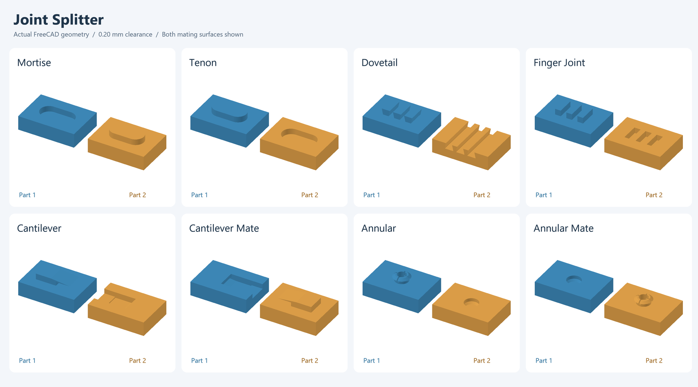
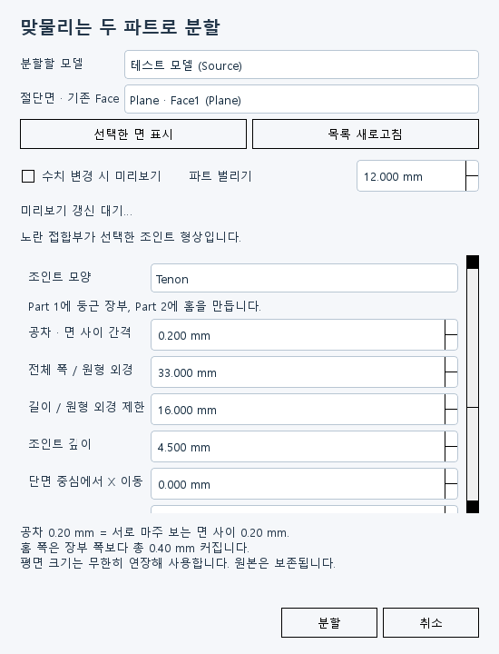
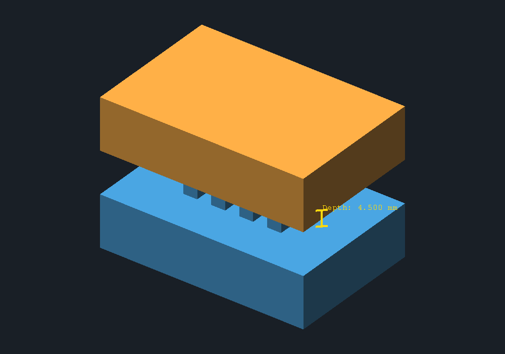

# Joint Splitter for FreeCAD

**3D 모델을 절단면으로 나누면서, 서로 맞물리는 조인트까지 함께 만드는 FreeCAD 워크벤치입니다.**

모델과 절단면을 지정하고 조인트 모양·치수·공차를 설정하면 암·수 조인트가 적용된 두 파트를 생성합니다. 큰 모델을 나눠 출력하거나, 분할한 부품의 결합부를 설계할 때 사용할 수 있습니다.



## 주요 기능

- **8가지 조인트:** Mortise, Tenon, Dovetail, Finger Joint, Cantilever, Cantilever Mate, Annular, Annular Mate.
- **기존 Face 선택:** 직접 만든 평면 Face를 절단면으로 사용합니다.
- **절단면 생성:** XY/YZ/XZ 평면 또는 화면의 세 점으로 평면을 만듭니다.
- **접합 공차 설정:** 서로 마주 보는 파트 표면 사이의 간격을 mm 단위로 지정합니다.
- **자동 미리보기:** 조인트 종류나 수치를 바꾸면 실제 분할 형상을 갱신합니다.
- **치수 하이라이트:** 입력칸을 클릭하면 해당 치수선이나 접합면을 노란색으로 표시합니다.
- **파트 벌리기:** 두 파트를 떨어뜨려 접합부를 확인합니다.
- **분할 후 수정:** 조인트 설정과 절단면을 수정하면 두 파트를 함께 재계산합니다.
- **원본 보존:** 원본 모델과 절단면을 남기고 독립된 결과 파트를 생성합니다.

## 실행 환경

| 항목 | 내용 |
| --- | --- |
| FreeCAD | 1.0 이상을 대상으로 개발 |
| 검증 환경 | Windows, FreeCAD 1.1.4 |
| 입력 모델 | 유효한 단일 솔리드 — Part 형상, Part Design Body, 솔리드로 가져온 STEP 등 |
| 절단면 | 모델 내부를 통과하는 별도의 평면 Face |
| 추가 패키지 | 별도 설치 없이 FreeCAD에 포함된 Python·Part·Qt·Coin 사용 |

다른 FreeCAD 버전과 운영체제는 별도 검증이 필요합니다. STL 등의 메시, 열린 셸, 여러 솔리드가 합쳐진 모델은 먼저 유효한 단일 솔리드로 준비해야 합니다.

## 설치 방법

### 방법 1. 설치 매크로 사용

1. [GitHub 저장소](https://github.com/ktw1525/Joint_freeCAD_addon)에서 **Code → Download ZIP**을 눌러 소스를 다운로드합니다. Git을 사용한다면 다음 명령으로 받을 수도 있습니다.

   ```bash
   git clone https://github.com/ktw1525/Joint_freeCAD_addon.git
   ```

2. ZIP 파일을 압축 해제하고, `Install.FCMacro`와 `InitGui.py`가 들어 있는 폴더를 확인합니다.
3. FreeCAD에서 **매크로 → 매크로…**를 엽니다.
4. 매크로 폴더를 압축 해제한 폴더로 지정하고 **Install.FCMacro**를 선택해 실행합니다.
5. 설치 완료 후 문서를 저장하고 **FreeCAD를 완전히 종료한 다음 다시 실행**합니다.
6. 상단 워크벤치 목록에서 **Joint Splitter**를 선택합니다.

설치 매크로는 FreeCAD 사용자 데이터 폴더의 `Mod/JointSplitter`에 필요한 파일을 복사합니다. 기존 설치가 있으면 업데이트 여부를 묻습니다.

### 방법 2. 수동 설치

1. FreeCAD의 **보기 → 패널 → Python 콘솔**을 열고 다음 명령으로 사용자 데이터 폴더를 확인합니다.

   ```python
   App.getUserAppDataDir()
   ```

2. 해당 폴더 아래에 `Mod/JointSplitter` 폴더를 만들고 저장소의 파일을 복사합니다.

   ```text
   <FreeCAD 사용자 데이터 폴더>/
   └── Mod/
       └── JointSplitter/
           ├── Init.py
           ├── InitGui.py
           ├── package.xml
           ├── joint_splitter/
           ├── resources/
           ├── docs/
           └── examples/
   ```

3. FreeCAD를 완전히 종료한 뒤 다시 실행하고 **Joint Splitter** 워크벤치를 선택합니다.

`JointSplitter/Joint_freeCAD_addon-main/InitGui.py`처럼 폴더가 한 단계 더 들어가지 않도록 주의하세요. `JointSplitter/InitGui.py`가 바로 있어야 합니다.

### 설치 없이 실행 / 업데이트

다운로드한 폴더의 **JointSplitter.FCMacro**를 실행하면 분할 창을 바로 열 수 있습니다. 이 방법으로 만든 파라메트릭 문서를 나중에 다시 열어 재계산하려면 워크벤치를 설치해 두세요.

업데이트할 때는 최신 소스를 다시 내려받아 `Install.FCMacro`를 실행하고 업데이트를 선택한 뒤 FreeCAD를 재시작합니다.

## 사용 방법

### 1. 모델과 절단면 지정

1. 분할할 모델이 있는 문서를 열고 **Joint Splitter** 워크벤치의 **조인트로 분할…**을 누릅니다.
2. 창 상단의 **분할할 모델**에서 솔리드를 선택합니다.
3. **절단면 · 기존 Face**에서 사용할 평면 Face를 선택합니다.

직접 만든 `Face`, 스케치로부터 생성한 `Part::Face`, Part 평면 등을 사용할 수 있습니다. 여러 평면 Face가 있는 면 객체는 `Face1`, `Face2` 등을 개별 선택합니다. 모델과 절단면은 **같은 문서**에 있어야 하며, 솔리드의 외벽이나 곡면은 절단면 목록에 포함하지 않습니다.

**선택한 면 표시**를 누르면 지정한 면을 화면에서 확인할 수 있습니다. 새 객체를 만든 뒤에는 **목록 새로고침**을 누르세요. 모델과 면을 Ctrl로 미리 선택한 뒤 분할 창을 여는 방식도 지원합니다.



### 2. 새 절단면 만들기

**축 방향 평면**

**절단면 선택 / 만들기…**에서 기준 모델을 지정하고 **XY 면 생성**, **YZ 면 생성**, **XZ 면 생성** 중 하나를 누릅니다. 평면은 모델 중심에 생성됩니다. 생성된 면의 **데이터 → Placement**에서 위치와 각도를 조절할 수 있습니다.

같은 창에서 **선택한 기존 Face 사용**을 눌러 이미 만든 면을 지정할 수도 있습니다.

**세 점으로 평면 그리기**

1. 모델을 선택하고 **절단면 그리기 (3점)…**을 누릅니다.
2. 3D 화면에서 서로 일직선에 놓이지 않은 세 점을 차례로 클릭합니다.
3. 세 번째 점을 지정하면 평면을 생성하고 모델과 함께 선택합니다.

물체 위를 클릭하면 해당 표면의 3D 좌표를, 빈 공간을 클릭하면 현재 화면 깊이의 좌표를 사용합니다. 정확한 위치가 필요하면 작업 패널의 **X/Y/Z** 값을 입력하고 **입력 좌표를 점으로 추가**를 누르세요. **마지막 점 취소**와 **Esc/취소**도 지원합니다.

생성된 면은 Placement로 편집할 수 있는 Part 평면입니다. 모델 내부를 통과하도록 배치하세요. **면의 표시 크기는 절단 범위를 제한하지 않으며, 계산할 때 무한 평면처럼 연장합니다.**

### 3. 조인트와 치수 설정

조인트 종류를 선택하고 필요한 치수를 입력합니다. 길이와 공차는 **mm**, 각도는 **도(°)** 단위입니다.

| 설정 | 의미 |
| --- | --- |
| 조인트 모양 | 생성할 조인트 종류 |
| 공차 · 면 사이 간격 | 서로 마주 보는 암·수 표면 사이의 간격 |
| 전체 폭 / 원형 외경 | 조인트의 로컬 X 방향 전체 범위 |
| 길이 / 원형 외경 제한 | 조인트의 로컬 Y 방향 범위 |
| 조인트 깊이 | 절단면에서 수 조인트 끝까지의 돌출 길이 |
| 단면 중심에서 X/Y 이동 | 단면 중심을 기준으로 조인트 위치 조절 |
| 절단면 내 회전 | 절단면 안에서 조인트 방향 조절 |
| 도브테일 각도 | Dovetail 옆면의 벌어짐 각도 |
| 핑거 개수 | Finger Joint와 Dovetail의 핑거 수 |
| 암수 방향 뒤집기 | 수 조인트가 붙는 파트 방향 반전 |

X/Y는 절단면 위의 로컬 방향입니다. 조인트의 기본 위치는 모델과 절단면이 만나는 단면의 경계 상자 중심이며, 불규칙한 단면에서는 크기와 위치를 직접 조절해야 할 수 있습니다.

### 4. 미리보기와 하이라이트 확인

**수치 변경 시 미리보기**를 켜면 입력을 멈춘 뒤 약 0.45초 후에 계산을 시작합니다. 복잡한 모델은 계산에 더 오래 걸릴 수 있습니다.

| 표시 | 의미 |
| --- | --- |
| 파랑 | Part 1 |
| 주황 | Part 2 |
| 노랑 | 선택한 치수선 또는 접합면 |

숫자 입력칸을 클릭하면 해당 치수의 방향과 범위를 표시합니다. 폭·길이·깊이는 치수선으로, 핑거 수는 번호로, 도브테일 각도는 각도선으로 표시합니다. 공차 입력칸을 선택하면 공차가 적용되는 실제 접합면을 강조합니다.

**파트 벌리기**로 두 파트를 떨어뜨려 접합부를 확인하세요. 값을 `0`으로 설정하면 조립 상태로 볼 수 있습니다. 이 값은 미리보기 표시만 바꾸며 실제 결과 형상과 공차에는 영향을 주지 않습니다. 설정 창을 열어 둔 상태에서 3D 화면을 회전하거나 확대할 수 있습니다.

미리보기는 문서 트리에 임시 파트를 추가하지 않습니다. **취소**하면 미리보기를 제거하고 원본 모델과 면의 표시 상태를 복구합니다.



### 5. 분할 및 내보내기

1. 미리보기에서 형상을 확인한 뒤 **분할**을 누릅니다.
2. 트리에 결과 그룹과 다음 객체가 생성됩니다.

   ```text
   결과 그룹
   ├── 조인트 설정 (수정 가능)
   ├── Part 1
   └── Part 2
   ```

3. 원본 모델과 절단면은 보존한 채 숨깁니다.
4. 각 결과 파트를 개별 선택하고 **파일 → 내보내기**로 STEP/STL 등 필요한 형식으로 저장합니다.

각 파트는 독립된 단일 솔리드입니다. Part 1은 원래 절단면 법선의 음수 쪽, Part 2는 양수 쪽에 해당합니다.

## 지원 조인트

| 종류 | 생성 형상 |
| --- | --- |
| Mortise | Part 1의 둥근 홈 + Part 2의 대응 장부 |
| Tenon | Part 1의 둥근 장부 + Part 2의 대응 홈 |
| Dovetail | 사다리꼴 핑거 + Y 방향 관통 홈 |
| Finger Joint | 직사각형 핑거 배열 + 대응 홈 |
| Cantilever | 탄성 변형 공간을 둔 외팔보 스냅 후크 + 대응 홈 |
| Cantilever Mate | Cantilever의 암·수 방향 반전 |
| Annular | 4개의 슬롯을 가진 원형 스냅 후크 + 대응 홈 |
| Annular Mate | Annular의 암·수 방향 반전 |

Annular 외경은 폭과 길이 중 작은 값을 사용합니다. Dovetail 홈은 옆으로 밀어 조립할 수 있도록 모델 끝까지 열립니다.

Cantilever와 Annular는 재료의 탄성, 후크 치수, 출력 방향에 맞춰 조절해야 하는 기본 형상입니다. 자동 강도·변형 해석은 포함하지 않으며, 실제 결합성과 내구성은 시험 출력으로 확인해야 합니다.

## 공차 설정 예시

이 애드온에서 공차는 **서로 마주 보는 표면 사이의 간격**을 뜻합니다. `0.20 mm`로 지정하면 다음과 같이 적용합니다.

- 장부 측면에서 대응하는 홈 측면까지의 간격: **0.20 mm**.
- 평행한 양쪽 벽이 있는 홈의 총 폭: 장부보다 **0.40 mm** 크게 생성.
- 평평한 절단면 사이의 총 간격: 양쪽에서 0.10 mm씩 제거하여 **0.20 mm** 확보.

곡면과 경사면은 표면 법선 방향의 오프셋으로 홈을 확장합니다. 공차가 `0`이면 두 형상이 정확히 맞닿습니다. 프린터와 재료에 맞는 값은 시험 출력으로 결정하세요.

## 분할 후 수정

결과 그룹의 **조인트 설정 (수정 가능)**을 선택하고 **데이터** 탭에서 속성을 변경합니다.

`JointType`, `Clearance`, `Width`, `Length`, `Depth`, `Count`, `DovetailAngle`, `Rotation`, `OffsetX`, `OffsetY`, `Reverse`를 수정하면 두 파트가 함께 재계산됩니다. 원본 모델이나 절단면의 Placement를 변경해도 결과가 갱신됩니다.

FCStd로 저장했다가 다시 열어 수정할 수 있습니다. 원본의 토폴로지가 바뀌어 면 번호가 달라졌다면 `CuttingFace` 참조를 다시 지정하세요. 유효하지 않은 치수로 변경하면 `Status`에 오류를 표시하고 결과 형상을 비웁니다. 치수를 수정하면 다시 생성합니다.

## 문제 해결

| 증상 | 확인할 사항 |
| --- | --- |
| 워크벤치가 목록에 없음 | FreeCAD를 완전히 종료한 뒤 재실행했는지, `Mod/JointSplitter/InitGui.py` 위치가 올바른지 확인합니다. |
| 만든 Face가 목록에 없음 | 같은 문서의 평면 Face인지 확인하고 **목록 새로고침**을 누릅니다. 곡면이나 솔리드 외벽은 목록에 포함하지 않습니다. |
| 절단면이 모델을 통과하지 않는다는 오류 | 면의 Placement를 수정해 모델 내부를 지나도록 배치합니다. |
| 조인트가 모델 외부 또는 빈 공간으로 나간다는 오류 | 폭·길이·깊이를 줄이거나 X/Y 이동으로 조인트 위치를 바꿉니다. |
| 핑거가 서로 겹친다는 오류 | 핑거 수·깊이·각도·공차를 줄이거나 전체 폭을 늘립니다. |
| 분할 결과가 여러 조각이라는 오류 | 절단면 위치나 조인트 치수를 조정합니다. 각 결과는 하나의 솔리드여야 합니다. |
| 미리보기 계산이 느림 | **수치 변경 시 미리보기**를 끄고 치수를 설정한 뒤 다시 켭니다. |
| 저장한 문서를 다시 열었을 때 재계산이 안 됨 | 워크벤치가 설치되어 있는지 확인합니다. |

현재는 **모델 하나에 한 쌍의 조인트 영역**을 생성합니다. 여러 위치의 조인트 자동 배치와 곡면을 이용한 분할은 지원하지 않습니다.

## 예제와 개발

설치 후 [예제 문서](examples/JointSplitterDemo.FCStd)를 열고 조인트 설정의 `Clearance` 등을 변경해 볼 수 있습니다. [Demo.FCMacro](examples/Demo.FCMacro)는 새 모델과 절단면을 만들고 설정 창을 엽니다.

테스트는 저장소 루트에서 FreeCAD에 동봉된 Python으로 실행합니다. 일반 Python에는 FreeCAD와 Part 모듈이 포함되어 있지 않습니다.

```powershell
& '<FreeCAD 설치 폴더>\bin\python.exe' tests/test_geometry.py -v
& '<FreeCAD 설치 폴더>\bin\python.exe' tests/test_gui.py
```

형상·문서 테스트 18개와 GUI·미리보기 테스트 18개로 조인트 생성, 실제 공차, 회전 절단면, 저장·재열기, Face 선택, 3점 그리기, 치수 강조 및 취소·문서 종료 시 정리를 검증했습니다. 미리보기 이미지는 Coin 오프스크린 렌더러로 확인했습니다. Qt 오프스크린 테스트와 실제 데스크톱 뷰포트의 수동 검증은 구분합니다.

배포 ZIP은 다음 명령으로 생성합니다. 생성물은 `dist/`에 저장되며 Git 추적 대상에서 제외됩니다.

```bash
python tools/build_release.py
```

## 참고 및 라이선스

[mwganson/joint](https://github.com/mwganson/joint)의 조인트 종류와 사용 개념을 참고했습니다. 해당 프로젝트는 면에 조인트를 만드는 매크로이며, Joint Splitter는 절단면을 기준으로 대응하는 두 파트를 함께 생성하는 별도 구현입니다. 참고 프로젝트의 소스 코드와 스크린샷은 포함하지 않았습니다.

이 프로젝트는 [MIT 라이선스](LICENSE)로 배포합니다.
